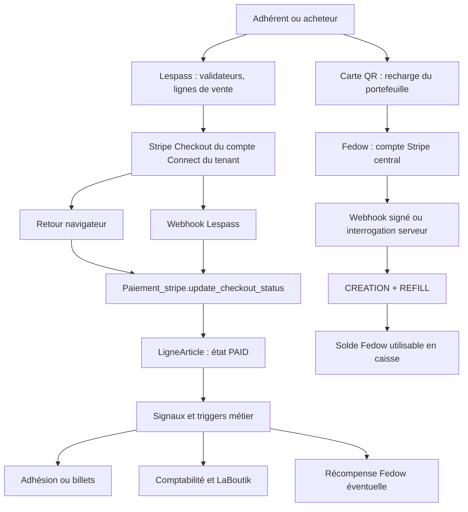

# Cartographie et analyse de Stripe

Les références de lignes des annexes concernent le commit initial, avant les
modifications CAWL. Le domaine tenant, le schéma PostgreSQL et les permissions
font partie de chaque chemin de paiement.

## Architecture observée

## Parcours applicatifs et points d'entrée

| Parcours | Routes ou déclencheur | Chaîne de code et effets |
| --- | --- | --- |
| Réservation web | `/event/`, actions du `EventMVT` | `BaseBillet/validators.py::ReservationValidator` → `CreationPaiementStripe` → checkout ; retour `EventMVT.stripe_return` → validation → billets, emails, jauge et vente |
| Adhésion ponctuelle | `/memberships/` | `MembershipValidator.get_checkout_stripe` → ligne, paiement, M2M de l'adhésion → retour `MembershipMVT.stripe_return` → deadline et confirmation |
| Adhésion soumise à validation | `/memberships/<uuid>/get_checkout_for_membership/` | Réutilisation d'une session ouverte ; refus d'une nouvelle session lorsque le débit est soumis ; états `ADMIN_VALID` et `PAYMENT_PENDING` |
| Adhésion récurrente | Tarif `recurring_payment=True` | Session en mode subscription ; enregistrement de l'abonnement ; `invoice.paid` sur renouvellement ; nouvelle ligne et nouvelle facture, compteur d'itérations et deadline |
| Désactivation du renouvellement | API `CancelSubscription` | Contrôle de propriété par adhésion et utilisateur ; `Subscription.modify(cancel_at_period_end=True)` ; avantages conservés jusqu'à l'échéance |
| Contribution Crowds | `/crowd/` et `/contrib/` | `crowds/views.py` crée paiement et contribution ; `contribution_stripe_return` et webhook finalisent statut, ligne et email indépendamment du navigateur |
| Recharge QR / compte | `/my_account/refill_wallet/` | `WalletFedow.get_federated_token_refill_checkout` → API Fedow signée par le wallet et le lieu → Stripe central |
| Retour de recharge | `/my_account/<uuid>/return_refill_wallet/` | `retrieve_from_refill_checkout` demande à Fedow de vérifier le paiement ; Fedow réalise le crédit et retourne le portefeuille |
| Remboursement total | Actions admin réservation | `Reservation.cancel_and_refund_resa` → refund distant → lignes négatives avec TVA d'origine → LaBoutik → annulation des billets |
| Remboursement partiel | Actions admin billet | `Reservation.cancel_and_refund_ticket` : contrôle du billet, refus d'un billet scanné, remboursement d'une unité et ligne négative |
| Avoir hors ligne | Même administration | `_lignes_hors_stripe` et `_creer_avoir` : espèces, chèque, carte terminal ou autres ventes hors checkout ; aucune opération PSP requise |
| Création du compte Connect | `/stripe/onboard/from_config/` | `Configuration.get_stripe_connect_account` crée un compte Standard ; `AccountLink.create` redirige vers le KYC Stripe |
| Retour Connect | `/stripe/onboard/return_from_config/<id>/` | Lecture du compte, `details_submitted`, `payouts_enabled`, déblocage des produits payants |
| Versement fédéré | Événement `transfer.created` | Recherche du tenant par compte destinataire ; `global_asset_bank_stripe_deposit` → dépôt Fedow → information LaBoutik et historique du paiement |
| Vente LaBoutik / API v2 | `/api/v2/` | `api_v2/serializers.py` distingue vente déjà encaissée au POS et paiement en ligne. Les ventes caisse gratuites/espèces/carte ne doivent pas créer de checkout |
| Récompense adhésion/billet | Triggers et tâches | `refill_from_lespass_to_user_wallet_*` : rémunération/reward d'un asset, distincte d'une recharge achetée à un PSP |

Les routes DRF peuvent fonctionner avec ou sans slash final suivant la
configuration du routeur. Le code conserve plusieurs noms `stripe_return` dans
les URLs de retour ; ces noms constituent aussi un contrat de liens existants.

## Fichiers centraux : raison du couplage

| Fichier | Fonction et raison de modification |
| --- | --- |
| `PaiementStripe/views.py` | Création de session, mode payment/subscription, line items Stripe, URLs, retry sur prix invalides, SEPA rejeté, facture récurrente et KYC |
| `BaseBillet/models.py` | Le SDK est utilisé dans les modèles : compte, catalogue, prix, statut, abonnement et remboursement. Ce n'est pas une couche confinée à `PaiementStripe` |
| `BaseBillet/validators.py` | Choix de moyens de paiement, montants libres, minimum positif, metadata, génération des lignes et du checkout ; contient aussi du code de création de tenant historique |
| `BaseBillet/views.py` | Redirections, retours, réutilisation des paiements en attente et recharge Fedow ; le GET ne peut pas être la preuve de paiement |
| `ApiBillet/views.py` | Webhook multi-tenant, renouvellement, transfert, anciennes validations, abonnement et recharge legacy |
| `BaseBillet/signals.py` | Machine d'état du paiement et des lignes ; les changements d'état provoquent des effets métier et des synchronisations |
| `BaseBillet/triggers.py` | Activation d'adhésion, mise à jour des itérations, arrêt d'abonnement, confirmation et distribution vers les autres services |
| `BaseBillet/tasks.py` | Emails, factures PDF, vente et refund LaBoutik, dépôts bancaires, rewards et notifications ; retries Celery et marqueurs d'envoi |
| `fedow_connect/fedow_api.py` | Transport signé vers Fedow, création/récupération du portefeuille, demande de checkout, interrogation du paiement et distribution des rewards |
| `fedow_connect/validators.py`, `fedow_public/models.py` | Contrat des réponses, assets, monnaies et métadonnées Fedow ; les noms historiques Stripe ne sont pas tous des appels PSP |
| `crowds/views.py`, `crowds/models.py`, `crowds/tasks.py` | Contribution, ligne associée, finalisation et email ; traitement explicite car la catégorie de produit ne lance pas les triggers d'une adhésion |
| `root_billet/models.py` | Clés de la plateforme ; mode test/live et stockage chiffré de la clé live |
| `MetaBillet/models.py` | Catalogue partagé et metadata historiques, ancien suivi d'onboarding ; des champs restent après suppression du parcours legacy |
| `Administration/admin/products.py` et template associé | Accès aux produits payants conditionné au compte Stripe ; ce verrou doit devenir propre au prestataire choisi |
| `Administration/admin_tenant.py` | Configuration, lecture des paiements, actions de remboursement et règles Crowds ; données historiques à conserver |
| `Administration/management/commands/install.py` | Vérification de clé Stripe lors de l'installation ; doit accepter un bootstrap CAWL |
| `stripe_reset.py`, `backfill_membership_payment_pending.py`, `launch_payment.py` | Outils de maintenance et de rapprochement historique ; ne doivent pas provoquer d'appels Stripe après la bascule |
| `comptabilite/services.py`, exporteur de lignes | Totaux, taxes, avoirs, remboursements et libellés par moyen de paiement ; préserver la distinction CAWL/Stripe |
| `api_v2/serializers.py` | Contrat externe, origine caisse et `stripeSubscriptionId` historique ; une compatibilité de lecture n'est pas un nouveau souscripteur CAWL |
| `TiBillet/settings.py`, URLconf publics/tenants | Applications installées, routage, schémas et endpoints de callbacks |
| `deploy/tools/runtime/*` | Génération des environnements, secrets, mode smoke/live, réconciliation des clés, domain pairing et visibilité du bouton recharge |

Tous les autres fichiers sont localisés dans `files.tsv` ; chaque fonction
englobante est dans `symbols.tsv`. Les templates, traductions, migrations et
anciens parcours sont inventoriés afin de distinguer le code utilisé des traces
historiques.

## Opérations Stripe applicatives Lespass

| Opération | Emplacements principaux au commit initial |
| --- | --- |
| `Account.create` | `BaseBillet/models.py:798` |
| `Account.retrieve` | `BaseBillet/models.py:887`, `BaseBillet/validators.py:1069`, `PaiementStripe/views.py:480` |
| `AccountLink.create` | `PaiementStripe/views.py:401`, `:449` |
| `Product.create`, `Product.retrieve` | `BaseBillet/models.py:2087`, `:2156` |
| `Product.list` | `Administration/management/commands/install.py:84`, `:87` |
| `Price.create` | `BaseBillet/models.py:2183` |
| `checkout.Session.create` | `PaiementStripe/views.py:182`, `:195`, `:218` |
| `checkout.Session.retrieve` | `BaseBillet/models.py:2819`, `BaseBillet/views.py:2891`, `ApiBillet/views.py:824`, backfill `:162` |
| `PaymentIntent.retrieve`, `PaymentMethod.retrieve` | `BaseBillet/models.py:2851`, `:2872` |
| `Subscription.retrieve`, `Subscription.modify` | Modèle du paiement, annulation API, triggers de renouvellement et validateur legacy |
| `Invoice.retrieve` | `PaiementStripe/views.py:256`, `BaseBillet/views.py:287`, `ApiBillet/views.py:800` |
| `Refund.create` | `BaseBillet/models.py:2389`, `:2481` |
| `Transfer.retrieve` | `ApiBillet/views.py:1251` |

La liste complète par emplacement, incluant les archives, est `sdk-calls.tsv`.

## États et invariants financiers à conserver

| Niveau | États / règle |
| --- | --- |
| Paiement | `PENDING`, `PAID`, `VALID`, `NOTSYNC`, `FAILED`, `EXPIRE`, `CANCELED`, `REFUNDED` |
| Ligne | `UNPAID`, `PAID`, `VALID`, `FAILED`, `REFUNDED`, `CREDIT_NOTE` |
| Adhésion | Validation admin, paiement soumis, ponctuel, automatique, annulé ; date d'avantages distincte du renouvellement |
| Réservation/billet | Payé ne signifie pas encore billet envoyé ; refus du refund d'un billet scanné |
| Fedow | Une création monétaire doit adosser chaque recharge ; le crédit ne doit apparaître qu'une fois |
| Comptabilité | Montants en centimes, quantité, TVA, devise, moyen, ligne d'origine et historique immuables |
| Asynchrone | Retour navigateur et webhook peuvent se croiser ; un retry ne doit pas doubler vente, email, monnaie ou remboursement |

`traitement_en_cours` est un marqueur métier historique. Il ne remplace pas un
verrou de base ni un journal d'événements. Les modèles CAWL ajoutent leurs
identifiants et journaux sans insérer un identifiant CAWL dans un champ Stripe.

## Fedow et LaBoutik : sources exactes des images

| Projet | Commit | SHA-256 de l'archive contrôlée |
| --- | --- | --- |
| `TiBillet/Fedow` | `1668d94fb2391cd1b9fef28abf857c356e13207c` | `4532584ea066d01b9d69874f2285fa9a983ce49cb3e3ade84f76692a2d22bd24` |
| `TiBillet/LaBoutik` | `3fdba313c2dea172bfaa6a06ebab05e1caf62490` | `9cb955f13e545b883ca86c65baf73d8ff53b82d1c563d8fe7e8aab0274763dfd` |

Fedow expose les permissions `HasPlaceKeyAndWalletSignature` pour initier une
recharge depuis Lespass. Son webhook Stripe vérifie la signature via `IsStripe`.
`StripeAPI.validate_stripe_checkout_and_make_transaction` lit le paiement chez
Stripe, vérifie les métadonnées signées et appelle `TransactionW2W`. Ce dernier
écrit `CREATION` puis `REFILL` atomiquement, conserve la création associée,
vérifie les hashes et protège les doubles créations liées au checkout.

L'extension CAWL utilise cette même écriture monétaire native. Les identifiants
CAWL restent dans une table et des metadata propres. La catégorie historique
`FED` et les soldes ne sont pas renommés : les renommer ou recréer une monnaie
modifierait le sens de la chaîne et la compatibilité des caisses.

LaBoutik valide le moyen de paiement envoyé par Lespass contre
`MoyenPaiement.CATEGORIES`. Sans ajout du code `CW`, une vente CAWL serait
refusée avant d'être synchronisée. L'extension de cette liste et la création du
moyen `CAWL (en ligne)` font donc partie de la migration.

## Constats de code à traiter ou surveiller

1. Le webhook Lespass initial repose sur `TenantAdminApiPermission`, alors que
   Fedow emploie une signature Stripe. Les mécanismes ne sont pas interchangeables.
   Le nouveau webhook CAWL vérifie la signature du corps brut et le marchand.
2. Le KYC Connect actuel utilise `AllowAny` et un identifiant reçu dans l'URL.
   L'absence de contrôle visible reliant cet identifiant au tenant doit être
   examinée séparément si ce parcours legacy reste exposé.
3. Le catalogue et les prix sont créés chez Stripe depuis les modèles. Retirer
   seulement le checkout laisserait ces appels actifs.
4. Les remboursements Stripe historiques font des appels externes depuis des
   méthodes atomiques. Un rollback SQL ne peut pas annuler un refund distant.
   Le parcours CAWL enregistre une opération déterministe avant l'appel et suit
   sa confirmation, avec une clé d'idempotence stable.
5. Plusieurs états Stripe sont déduits de chaînes spécifiques. Les états CAWL
   doivent être traduits explicitement ; une autorisation n'est pas une capture.
6. Les mandats, numéros d'abonnement, factures et sessions Stripe historiques
   restent liés à Stripe. Les réécrire avec un nouveau préfixe ne les migre pas.
7. Les versements `transfer.created`, les WisePOS et les reversements entre
   organisations ont une logique distincte d'un paiement e-commerce simple.
8. Les données de configuration Stripe test/live existent à plusieurs niveaux.
   Un paiement CAWL est rapproché avec le marchand et le mode enregistrés à sa
   création ; un changement de compte n'est pas accepté silencieusement.

Ces constats proviennent de l'analyse statique et des tests isolés. Les volumes
réels, le stock de paiements en attente et la configuration du gala en service
restent à inventorier avant le déploiement.
