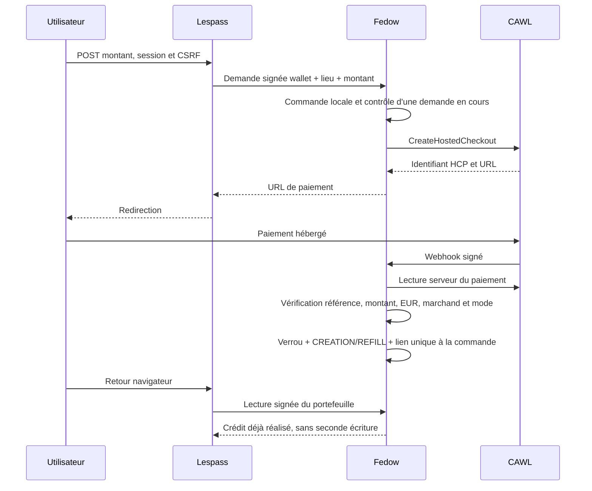

# Modifications de la branche de migration

La branche garde la bascule explicite par `PAYMENT_PROVIDER`. Le choix `cawl`
active le nouveau parcours. Les modèles et les tables historiques sont
conservés pour les ventes, les adhésions, les billets et les exports.

## Composants ajoutés

| Emplacement | Rôle |
| --- | --- |
| `payment_providers/cawl.py` | Client commun utilisant le SDK officiel ; configuration, HCP, lecture du paiement, refund, signature et rapprochement montant/devise/référence |
| `PaiementCawl/models.py` | Paiement CAWL associé au paiement métier existant, événement traité, remboursement et allocations comptables |
| `PaiementCawl/services.py` | Création et finalisation des paiements ponctuels ; verrou sur commande/adhésion ; rattachement immédiat du paiement en cours ; contrôle du tenant marchand |
| `PaiementCawl/refunds.py` | Suivi total/partiel, quantité restant remboursable, opération déterministe, confirmation et contrepassation comptable |
| `PaiementCawl/views.py` | Webhook signé ; réponse de succès après traitement, rollback et réponse retry en cas d'échec |
| `PaiementCawl/validators.py` | Montant de recharge validé avec DRF |
| `PaiementCawl/management/commands/reconcile_cawl_refunds.py` | Relecture des refunds qui n'ont pas encore été comptabilisés |
| `deploy/Fedow/cawl_fedow/` | Application d'intégration dans l'image Fedow : checkout, authentification native, journal, crédit unique et réutilisation d'une demande en cours |
| `deploy/Fedow/cawl_fedow/management/commands/install.py` | Installation d'un portefeuille et asset primaires avec les primitives natives, sans créer un catalogue Stripe |
| `deploy/Laboutik/cawl_laboutik/` | Compatibilité du moyen de paiement `CW`, dans la validation et la configuration de LaBoutik |
| Template `refill_cawl.html` | Formulaire serveur avec CSRF pour choisir le montant de recharge |

## Points d'intégration existants modifiés

- `CreationPaiementStripe` conserve son nom de compatibilité, mais délègue à
  CAWL lorsque le nouveau prestataire est sélectionné. Les appelants de billets,
  d'adhésions et de Crowds utilisent donc la même porte d'entrée métier.
- `Paiement_stripe.get_checkout_session` et `update_checkout_status` délèguent
  aux services CAWL pour les paiements disposant d'une fiche CAWL.
- Les identifiants HCP et paiement CAWL ne sont jamais écrits dans
  `checkout_session_id_stripe`, `payment_intent_id` ou `subscription`.
- Le code de paiement `CW` est ajouté à `PaymentMethod`, aux lignes,
  adhésions et billets. Les choix classiques hors ligne restent distincts.
- La méthode de paiement est propagée aux adhésions et billets associés.
- Le retour d'adhésion réutilise l'accès au checkout du modèle, au lieu de
  contourner la couche métier avec un appel direct au SDK Stripe.
- Le produit/prix soldé ne crée plus d'identifiant Stripe dans le nouveau
  parcours. Le montant issu du validateur Lespass est transmis à CAWL.
- Les administrateurs voient le prestataire CAWL et son mode de configuration
  dans le composant de création de produits payants.
- La demande de recharge Fedow accepte le montant validé par Lespass et
  conserve les permissions RSA et clé de lieu de l'API native.
- Les méthodes publiques de remboursement délèguent au parcours CAWL avant
  d'entrer dans le bloc atomique du refund Stripe historique.
- Les accès aux clés et routes Stripe concernés sont bloqués en mode CAWL,
  y compris les commandes natives Fedow via le garde explicite de son app.

## Chemin CAWL d'une recharge

## Migrations

| Migration | Effet |
| --- | --- |
| `BaseBillet/0222_alter_lignearticle_payment_method_and_more.py` | Ajout de `CW` aux choix de paiement, sans réécriture de l'historique |
| `PaiementCawl/0001_initial.py` | Tables de paiement CAWL et journal d'événements |
| `PaiementCawl/0002_cawlrefund.py` | Journal d'opérations de remboursement |
| `cawl_fedow/0001_initial.py` | Commandes de recharge et lien unique vers la transaction native de crédit |

La monnaie `FED`, sa chaîne, ses wallets et ses soldes sont conservés. Les
migrations historiques Stripe restent nécessaires pour reconstruire la base.

## Construction et exploitation

Le SDK est épinglé dans `pyproject.toml` et `poetry.lock`. Fedow installe le
même SDK dans son image. Les Dockerfiles copient explicitement les fichiers
des extensions afin que le contrat d'offre de sources puisse les retrouver.
La portée de `application_images.py` autorise le client commun pour Fedow.

`materialize-runtime-env.py` accepte le schéma CAWL et injecte le prestataire,
le mode, les identifiants et le schéma tenant. LaBoutik reçoit seulement le
sélecteur de prestataire. La vérification de mode smoke/live reste obligatoire.
L'option CLI historique `--stripe` reste compatible avec `--payment`.

Le champ de configuration runtime historique `SHARED_STRIPE_SECRET_ARN`
désigne encore le secret d'intégration. Le validateur de cette branche accepte
une ARN d'intégration CAWL. Le schéma interne du secret décide du prestataire.
Le renommage de ce champ et les politiques IAM distantes restent des opérations
de configuration à traiter avant une promotion CAWL.

## Étendue de la livraison

Cette branche est une **candidate de migration**, soumise à la qualification
décrite dans les fichiers suivants. Elle ne contient pas de moteur d'abonnements
CAWL, de portage WisePOS ni de refund automatisé des tokens d'un portefeuille.
Ces limites sont explicites et les opérations correspondantes sont refusées,
plutôt que dirigées vers le mauvais prestataire.
